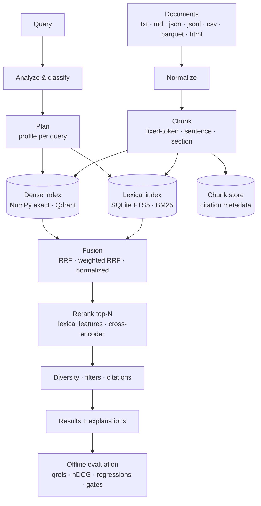
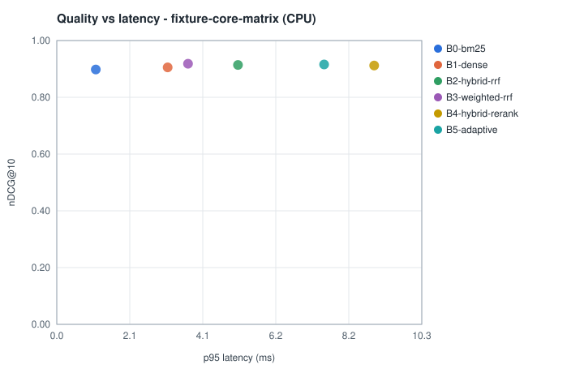

# SearchForge

> SearchForge is a production-oriented retrieval engineering platform for lexical, dense and hybrid search, multi-stage reranking, query planning, citation-ready context generation and reproducible search-quality evaluation.

CPU-first. Every index, search, test, evaluation, benchmark, CI stage and demo in this repository runs on a
laptop CPU with 16 GB RAM — no GPU, no API key, no external search service. Neural models, Qdrant and
OpenSearch are optional adapters behind the same interfaces.

```bash
uv sync --extra dev                         # Python 3.11+
uv run searchforge demo                     # fixture corpus → indexes → hybrid → rerank → evaluate → report
uv run searchforge demo adaptive            # query-planned routing vs always hybrid + rerank
```

---

## Why SearchForge

The engineering question this project is built around:

> **When should we use lexical search, dense retrieval, hybrid retrieval or reranking — and how do we measure
> whether a more complicated retrieval stack improves relevance enough to justify its latency and compute cost?**

SearchForge is retrieval infrastructure, not a vector-database wrapper or a chat-with-your-PDF app. It treats
search like any other production system: versioned immutable indexes, typed configuration, explicit interfaces,
degraded-mode handling, telemetry with privacy defaults, and — above all — **relevance judgments, per-query
regression analysis and release gates** instead of vanity metrics.

## Architecture



Clean architecture: `CLI / API → application services → domain → ports → adapters`. Backend objects (SQLite,
Qdrant, OpenSearch, FastAPI, ML models) never enter domain code — see [`ports.py`](src/searchforge/ports.py)
and [docs/architecture/overview.md](docs/architecture/overview.md).

| Layer | Modules |
|---|---|
| Corpus | [`ingestion/`](src/searchforge/ingestion) streaming readers with path/size/encoding safety · [`parsing/`](src/searchforge/parsing) normalization · [`chunking/`](src/searchforge/chunking) |
| Index | [`indexes/`](src/searchforge/indexes) SQLite FTS5, NumPy, Qdrant, OpenSearch, versioned lifecycle · [`embeddings/`](src/searchforge/embeddings) |
| Query | [`query/`](src/searchforge/query) analysis, classification, rewriting, planning |
| Retrieval & ranking | [`retrieval/`](src/searchforge/retrieval) · [`fusion/`](src/searchforge/fusion) · [`reranking/`](src/searchforge/reranking) · [`ranking/`](src/searchforge/ranking) · [`filtering/`](src/searchforge/filtering) |
| Serving | [`service/`](src/searchforge/service) · [`api/`](src/searchforge/api) · [`caching/`](src/searchforge/caching) · [`context/`](src/searchforge/context) · [`observability/`](src/searchforge/observability) |
| Evaluation | [`evaluation/`](src/searchforge/evaluation) · [`hard_negatives/`](src/searchforge/hard_negatives) · [`benchmarking/`](src/searchforge/benchmarking) · [`reporting/`](src/searchforge/reporting) |

## Corpus pipeline

- **Formats:** plain text, Markdown (YAML front matter, ATX sections), JSON, JSONL, CSV, Parquet (record batches), HTML (scripts/styles dropped).
- **Bounded memory:** generators end to end; Parquet is read batch by batch; index writes are batched.
- **Safety:** path containment, glob `..` rejection, symlinks skipped, file/record size limits, explicit malformed-encoding policy.
- **Normalization:** NFC, line endings, control/zero-width characters, horizontal whitespace — structure (newlines, headings, identifiers, casing) is preserved.
- **Stable ids:** document ids come from source identity, never from content or indexing config; content hashes detect changes; chunk ids include the chunker fingerprint.
- **Chunkers:** `FixedTokenApproxChunker`, `SentenceChunker`, `SectionChunker` — configurable size/overlap/minimum, exact character offsets (`text[start:end] == chunk.text`, property-tested).

## Lexical retrieval

SQLite FTS5 with `bm25()` (negated so higher is better), `porter unicode61` tokenizer, title/section column
weighting and typed metadata filters — all values bound as parameters. User text becomes a MATCH expression of
quoted tokens and phrases, so FTS5 operators in queries are inert. → [docs/methodology/bm25.md](docs/methodology/bm25.md)

## Dense retrieval

`EmbeddingProvider` and `VectorIndex` are separate abstractions ([ADR-003](docs/adr/ADR-003-separate-embedding-provider-from-vector-index.md)).

| Provider | Purpose |
|---|---|
| `HashEmbeddingProvider` | deterministic feature hashing — **tests/CI only, not semantic** |
| `TfidfEmbeddingProvider` | classical CPU baseline: TF-IDF + LSA fitted on the corpus, pickle-free persistence |
| `SentenceTransformerEmbeddingProvider` | optional `[neural]`, CPU, offline unless explicitly allowed, pinned revision |
| `RemoteEmbeddingProvider` | OpenAI-compatible endpoint; corpus text sent only with explicit opt-in |

Exact inner-product search over L2-normalized float32 vectors (memory-mapped, blockwise top-k, filter masks) is
the evaluation baseline; Qdrant (`query_points`) is the scale-out adapter. Embeddings are cached by
(text hash, model, revision, preprocessing version).

## Hybrid search & fusion

Lexical and dense candidate lists are retrieved concurrently and fused:

- **RRF** — `score(d) = Σ_i w_i / (k + rank_i(d))`, k = 60, rank-based and calibration-free (default, [ADR-004](docs/adr/ADR-004-rrf-default-hybrid-fusion.md));
- **Weighted RRF** — tuned only on train, selected on validation, reported once on test (`searchforge tune`);
- **Normalized score fusion** — min-max or z-score per list; raw BM25 and cosine are never added directly.

→ [docs/methodology/ranking-fusion.md](docs/methodology/ranking-fusion.md)

## Reranking

Two-stage retrieval: fast retrievers produce top-N candidates, a reranker re-scores them, top-k are returned.
`NoOpReranker`, the CPU `LexicalFeatureReranker` (coverage, title, phrase, identifier, proximity, rank prior)
and an optional Sentence-Transformers `CrossEncoderReranker`. Rerankers must return the same candidate set
(contract-tested); a reranker timeout falls back to the fused order and marks the response degraded.

## Query planning

Deterministic analysis (tokens, quoted phrases, identifiers such as `ERR-4012` or `RetryPolicy.max_attempts`,
numbers, question words, whitelisted `field:value` filters) classifies each query as identifier, keyword,
natural-language, complex-semantic or filter-heavy. The **static planner** maps classes to profiles
(identifier → lexical, complex → hybrid + rerank, otherwise hybrid). An optional `LLMQueryPlanner` treats model
output as untrusted and falls back to the static plan. Rewriting (whitespace, formatting noise, acronym
expansion, synonym multi-query) is always recorded — original, rewritten, strategies.

## Caching

- **Query-result cache:** bounded LRU (entries, approximate bytes, TTL); the key includes normalized query,
  canonical filters, **index version**, planner version, profile and top-k — a new index version can never serve
  stale results. Degraded responses are never cached.
- **Embedding cache:** persistent SQLite, model/revision-aware, inspectable and clearable.

## Search evaluation

- Graded qrels (0–3) in JSONL / TREC TSV / Parquet; BEIR loader.
- Precision@k, Recall@k, HitRate@k, MRR, MAP, nDCG@k with hand-computed tests; chunk rankings collapse to
  documents before scoring ([definitions](docs/methodology/retrieval-metrics.md)).
- Runner: cache bypassed, warm-up, repeated latency measurement, per-query-type breakdown.
- **Retrieval regression:** baseline vs candidate per query — improved / regressed / unchanged, ΔnDCG, ΔRecall,
  ΔMRR, latency change, **critical-query** regressions — and YAML **quality gates** (`searchforge compare` exits 1).
- Train / validation / test splits for anything that is tuned.

## Failure analysis

Every relevant document missing from the top-k gets **evidence** (indexed? passes filters? rank in lexical,
dense, fused and final lists, duplicate pressure, rewrites) and a separately labelled rule-based
**hypothesis**: `missed_lexical_match`, `semantic_miss`, `bad_fusion`, `bad_rerank`, `filter_error`,
`duplicate_results`, `chunking_failure`, `query_rewrite_failure`, `index_staleness`.
Also: hard-negative mining, incident-to-search-eval (sanitized failing query → judgments → regression case),
blinded human review export/import, and click-log import that treats clicks as **weak, debiased** signals —
click ≠ relevance. → [docs/evaluation/](docs/evaluation)

## Citation context

`CitationContextBuilder` turns ranked chunks into a context package within a character or estimated-token budget,
suppressing overlapping windows, near-duplicates and single-document floods. Each item carries a stable citation
id that maps back to document, chunk, character span, title, section and URI. SearchForge produces evidence — it
does not generate answers ([ADR-006](docs/adr/ADR-006-retrieval-relevance-before-generation.md)).
`SearchForgeRetriever` (RAG) and a JSON-schema `search` tool (agents) are provided without framework dependencies.

## Serving

FastAPI: `GET /health`, `GET /ready`, `POST /search`, `POST /search/explain`, `GET /indexes`,
`GET /indexes/{id}`, `GET /metrics`. Per-retriever and overall deadlines, reranker timeout fallback, partial-failure
degraded mode (`degraded: true` plus reasons — never hidden), circuit breaker for remote backends.

```bash
uv run searchforge index build configs/evaluations/fixture.yaml
uv run searchforge serve configs/evaluations/fixture.yaml        # 127.0.0.1:8080
curl -s localhost:8080/search -H 'content-type: application/json' \
  -d '{"query": "continuous batching inference", "top_k": 5, "filters": {"category": "ml-infra"}, "profile": "hybrid"}'
```

## Observability

Prometheus metrics (requests by profile/status, end-to-end and per-stage latency histograms for p50/p95/p99,
cache events, errors, degraded reasons, result counts) with **low-cardinality labels only** — never query text or
ids. Optional OpenTelemetry spans (`query_analysis`, `lexical_retrieval`, `dense_retrieval`, `fusion`,
`reranking`). Traces record a query **hash** by default (`NONE | HASH_ONLY | REDACTED | FULL`,
[ADR-010](docs/adr/ADR-010-raw-queries-not-persisted-by-default.md)). A Grafana dashboard ships under
[`deployment/`](deployment).

## Jenkins

[`Jenkinsfile`](Jenkinsfile) is the CI ([ADR-008](docs/adr/ADR-008-jenkins-instead-of-github-actions.md)):
environment & lockfile validation → format → Ruff → strict mypy → unit → property → integration → search quality →
local index E2E → retrieval regression gate → security scan → package build → Docker build.
CPU only, offline models, `disableConcurrentBuilds()`, and only JUnit, coverage, a benchmark summary and the
wheel/sdist are archived. → [docs/ci/jenkins.md](docs/ci/jenkins.md)

## Quickstart

```bash
git clone https://github.com/M-amir1998/SearchForge-.git && cd SearchForge-
uv sync --extra dev                                   # add --extra qdrant / neural / opensearch / observability as needed
uv run searchforge doctor
uv run searchforge corpus inspect configs/evaluations/fixture.yaml
uv run searchforge index build configs/evaluations/fixture.yaml
uv run searchforge search "ERR-4012" --profile adaptive --explain
uv run searchforge search "rollback" --filters '{"published": {"gte": "2024-01-01"}}'
uv run searchforge evaluate configs/evaluations/fixture.yaml --split test
uv run searchforge compare lexical adaptive --split test          # per-query regressions + gates
uv run searchforge benchmark configs/benchmarks/core-matrix.yaml --out results/core-matrix
uv run searchforge storage status --config configs/evaluations/fixture.yaml
uv run searchforge storage clean --dry-run
```

Docker (non-root, CPU only): `docker compose up -d` starts only the API; Qdrant, Prometheus + Grafana and
OpenSearch are opt-in profiles with memory limits.

## Results

<!-- RESULTS:BEGIN -->
### LOCAL DEMONSTRATION RESULTS

> Synthetic fixture collection (48 documents, 20 held-out **test** queries), CPU only, measured by
> `searchforge demo`. These numbers demonstrate the methodology; they are not industry benchmarks,
> and differences of a few hundredths are within noise at this size.
> Environment: Python 3.12.13, Windows-11, 12 logical CPUs, 15.6 GB RAM, no GPU.

| System | nDCG@10 | Recall@20 | MRR | p50 | p95 Latency | QPS | Index Size |
|---|---|---|---|---|---|---|---|
| B0-bm25 | 0.898 | 0.925 | 0.931 | 0.59 ms | 1.10 ms | 1080 | 1.7 MB |
| B1-dense | 0.906 | 0.975 | 0.924 | 2.02 ms | 3.12 ms | 328 | 1.7 MB |
| B2-hybrid-rrf | 0.914 | 0.975 | 0.924 | 2.39 ms | 5.09 ms | 293 | 1.7 MB |
| B3-weighted-rrf | 0.918 | 0.975 | 0.925 | 2.47 ms | 3.69 ms | 250 | 1.7 MB |
| B4-hybrid-rerank | 0.912 | 0.975 | 0.920 | 5.83 ms | 8.92 ms | 119 | 1.7 MB |
| B5-adaptive | 0.916 | 0.975 | 0.920 | 2.69 ms | 7.51 ms | 223 | 1.7 MB |

Quality by query type (nDCG@10):

| Configuration | Keyword | Semantic | Identifier | Ambiguous | Filter |
|---|---|---|---|---|---|
| B0-bm25 | 1.000 | 0.677 | 1.000 | 0.926 | 0.949 |
| B1-dense | 1.000 | 0.722 | 0.981 | 0.919 | 0.956 |
| B2-hybrid-rrf | 1.000 | 0.725 | 0.981 | 0.926 | 0.988 |
| B3-weighted-rrf | 1.000 | 0.727 | 1.000 | 0.926 | 0.988 |
| B4-hybrid-rerank | 1.000 | 0.717 | 0.981 | 0.926 | 0.988 |
| B5-adaptive | 1.000 | 0.717 | 1.000 | 0.926 | 0.988 |

Candidate depth (hybrid + lexical-feature reranker) and chunking experiments:

| System | Chunks | nDCG@10 | Recall@20 | p95 |
|---|---|---|---|---|
| D20-rerank-20 | 117 | 0.913 | 0.975 | 3.76 ms |
| D50-rerank-50 | 117 | 0.912 | 0.975 | 6.78 ms |
| D100-rerank-100 | 117 | 0.912 | 0.975 | 10.41 ms |
| C1-fixed-64tok | 72 | 0.909 | 0.975 | 6.02 ms |
| C2-fixed-128tok-ov32 | 49 | 0.912 | 0.950 | 3.59 ms |
| C3-sentence-400 | 78 | 0.906 | 0.950 | 4.05 ms |
| C4-section-1200 | 117 | 0.914 | 0.975 | 4.58 ms |

Fusion tuning (weighted_rrf, weights chosen on validation, reported once on test): best weights {'lexical': 0.5, 'dense': 0.25}, test nDCG@10 0.918 vs unweighted RRF 0.914.

Adaptive planning vs always hybrid + rerank (all 56 fixture queries, `searchforge demo adaptive`):

| System | nDCG@10 | Recall@20 | MRR | p50 | p95 | QPS |
|---|---|---|---|---|---|---|
| always-hybrid-rerank | 0.882 | 0.952 | 0.902 | 5.26 ms | 7.47 ms | 153 |
| adaptive | 0.884 | 0.952 | 0.902 | 2.10 ms | 6.32 ms | 312 |
| always-lexical | 0.850 | 0.891 | 0.891 | 0.57 ms | 0.93 ms | 1365 |

The planner skipped the reranker for 48/56 queries and dense retrieval for 13/56; vs always-hybrid-rerank: 6 improved, 4 regressed, 46 unchanged (ΔnDCG@10 +0.003).

Full report: [results/local-demo/report.md](results/local-demo/report.md) · [adaptive](results/local-demo/adaptive_report.md) · 

### First public-dataset study: BEIR SciFact (CPU)

> 5,183 abstracts, 300 test claims; dense = TF-IDF + LSA (256 d), not a neural model.
> Produced by `searchforge benchmark configs/benchmarks/scifact.yaml`; the dataset is downloaded locally
> and never committed.

| System | nDCG@10 | Recall@20 | MRR | p50 | p95 Latency | QPS | Index Size |
|---|---|---|---|---|---|---|---|
| B0-bm25 | 0.687 | 0.863 | 0.659 | 4.57 ms | 7.80 ms | 372 | 73.9 MB |
| B1-dense | 0.467 | 0.691 | 0.433 | 23.84 ms | 34.80 ms | 69 | 73.9 MB |
| B2-hybrid-rrf | 0.594 | 0.853 | 0.549 | 24.21 ms | 38.98 ms | 68 | 73.9 MB |
| B4-hybrid-rerank | 0.622 | 0.823 | 0.589 | 34.87 ms | 44.17 ms | 45 | 73.9 MB |
| B5-adaptive | 0.607 | 0.839 | 0.568 | 33.01 ms | 44.18 ms | 44 | 73.9 MB |

Measured outcome: **B0-bm25** has the best nDCG@10 here. Against the BM25 baseline, B1-dense: 35 improved / 136 regressed queries (ΔnDCG@10 -0.220, Δp95 +27.0 ms); B2-hybrid-rrf: 51 improved / 84 regressed queries (ΔnDCG@10 -0.093, Δp95 +31.2 ms); B4-hybrid-rerank: 45 improved / 76 regressed queries (ΔnDCG@10 -0.065, Δp95 +36.4 ms); B5-adaptive: 46 improved / 85 regressed queries (ΔnDCG@10 -0.080, Δp95 +36.4 ms). With a weak classical dense retriever, adding hybrid fusion and reranking costs latency without improving relevance on this dataset — exactly the trade-off SearchForge is built to measure before adopting a more complex stack. The neural-embedding study is the next step.

Full report: [results/beir-scifact/report.md](results/beir-scifact/report.md)

<!-- RESULTS:END -->

## Limitations

- The fixture collection is small and synthetic; it demonstrates methodology, not general conclusions.
- The default dense baseline is TF-IDF + LSA. Neural embeddings and cross-encoders are implemented as optional
  adapters but are not part of CI and are not measured in the committed results.
- Exact NumPy search is intended for up to roughly hundreds of thousands of chunks; larger corpora belong in an
  ANN backend (Qdrant adapter). Incremental updates of Qdrant-backed indexes require a rebuild in v0.1.
- The OpenSearch adapter is implemented and unit-tested against its query DSL; live tests run only against an
  operator-provided cluster (`OPENSEARCH_URL`). pgvector is documented, not implemented.
- Latency numbers are in-process, single machine, and noisy at sub-10 ms scales.
- Evaluated rankings contain at most each profile's `candidate_k` chunks (50 by default, 20 for the D20
  depth system), so Recall@20 for shallow configurations reflects what they actually return.

## Roadmap

1. Neural study: MiniLM / BGE-small embeddings and an MS MARCO cross-encoder on SciFact (CPU), then NFCorpus/FiQA.
2. Adaptive planner study at scale: quality retained vs dense/rerank work avoided.
3. Learned query classifier trained on failure-derived and reviewed queries.
4. Qdrant incremental updates and server-side hybrid parity checks; pgvector adapter.
5. Significance testing (paired bootstrap / randomization) once query sets are large enough.

## Documentation

[Architecture](docs/architecture) · [Methodology](docs/methodology) · [Evaluation](docs/evaluation) ·
[Operations](docs/operations) · [ADRs](docs/adr) · [CI](docs/ci/jenkins.md) ·
[Current search stack research](docs/references/current-search-stack.md) · [Security](SECURITY.md) ·
[Contributing](CONTRIBUTING.md) · [Project status](PROJECT_STATUS.md)

## License

MIT — see [LICENSE](LICENSE).
