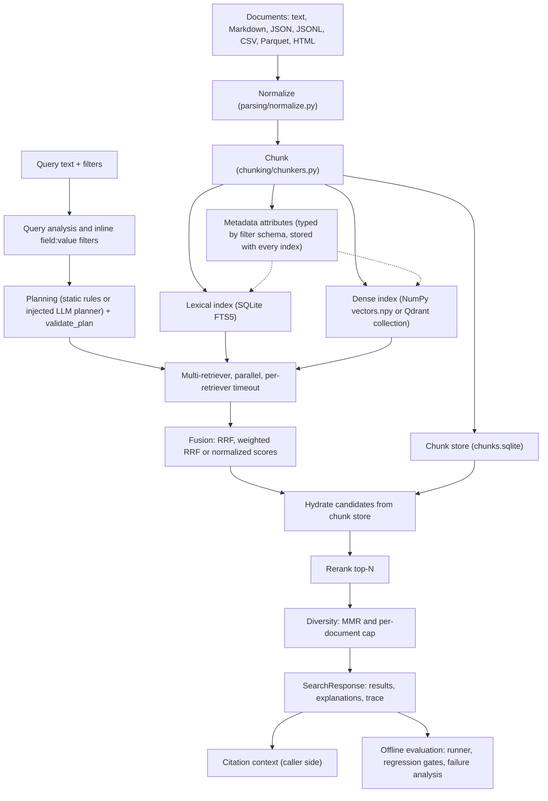

# Architecture overview

SearchForge is a CPU-first retrieval engineering platform. It ingests a corpus, builds versioned
lexical and dense indexes, executes planned multi-retriever searches with fusion, reranking and
diversification, and measures retrieval quality offline. This page maps the concerns to code and
states the dependency rules the code follows.

## Layers by concern

| Concern | What it does | Where it lives |
|---|---|---|
| Corpus | Streaming readers, safety limits, normalization, chunking, stable ids | [ingestion/](../../src/searchforge/ingestion/), [parsing/](../../src/searchforge/parsing/), [chunking/chunkers.py](../../src/searchforge/chunking/chunkers.py), [domain/ids.py](../../src/searchforge/domain/ids.py) |
| Index | Chunk store, SQLite FTS5, NumPy vectors, external adapters, embeddings, versioned layout | [indexes/](../../src/searchforge/indexes/), [embeddings/](../../src/searchforge/embeddings/) |
| Query | Analysis and classification, inline filters, rewriting, planning | [query/](../../src/searchforge/query/), [domain/filters.py](../../src/searchforge/domain/filters.py) |
| Retrieval | Retrievers, backend filter translation, rank fusion | [retrieval/retrievers.py](../../src/searchforge/retrieval/retrievers.py), [filtering/translate.py](../../src/searchforge/filtering/translate.py), [fusion/strategies.py](../../src/searchforge/fusion/strategies.py) |
| Ranking | Second-stage rerankers, MMR and per-document caps | [reranking/](../../src/searchforge/reranking/), [ranking/diversity.py](../../src/searchforge/ranking/diversity.py) |
| Serving | Search pipeline, timeouts, degraded mode, query cache, API, metrics, tracing | [service/](../../src/searchforge/service/), [api/app.py](../../src/searchforge/api/app.py), [caching/](../../src/searchforge/caching/), [observability/](../../src/searchforge/observability/) |
| Evaluation | Offline runs, metrics, regression gates, failure analysis, benchmarks, reports | [evaluation/](../../src/searchforge/evaluation/), [benchmarking/](../../src/searchforge/benchmarking/), [reporting/](../../src/searchforge/reporting/), [hard_negatives/](../../src/searchforge/hard_negatives/) |

Cross-cutting modules: [config/](../../src/searchforge/config/) (Pydantic models, YAML loading with
`include:`, built-in profiles), [storage/](../../src/searchforge/storage/) (disk budget, cleanup),
[errors.py](../../src/searchforge/errors.py) (every intentional failure derives from
`SearchForgeError`). Citation-ready context ([context/builder.py](../../src/searchforge/context/builder.py))
and the RAG / agent-tool adapters ([integrations/](../../src/searchforge/integrations/)) run on the
caller side, after a search returns; they are not a stage of `SearchService`.

## Dependency rule

```
CLI / API  ->  application services  ->  domain  <-  ports  <-  adapters
```

| Ring | Modules | May import |
|---|---|---|
| Interfaces | [cli/main.py](../../src/searchforge/cli/main.py), [api/app.py](../../src/searchforge/api/app.py) | everything below |
| Application services | `SearchService`, evaluation runner, query planning, fusion, reranking, diversity | ports, domain, config |
| Wiring | `IndexBuilder` ([indexes/builder.py](../../src/searchforge/indexes/builder.py)), `open_index` ([indexes/handle.py](../../src/searchforge/indexes/handle.py)), benchmark runner | binds concrete adapters (SQLite stores, NumPy, Qdrant, embedders) to the ports |
| Ports | [ports.py](../../src/searchforge/ports.py): `RetrievalRequest`, `Chunker`, `EmbeddingProvider`, `ChunkStore`, `LexicalIndex`, `VectorIndex`, `Retriever`, `FusionStrategy`, `Reranker`, `DocumentSourceReader` | domain, NumPy types |
| Domain | [domain/](../../src/searchforge/domain/): documents, chunks, filters, ids, manifest, judgments, query, results | itself and `errors` only |
| Adapters | SQLite chunk store and FTS5, NumPy vector index, Qdrant, OpenSearch, embedding providers | ports, domain, config |

Ports are `typing.Protocol` classes, so adapters satisfy them structurally rather than by
inheritance. No Qdrant, OpenSearch or FastAPI object crosses into domain code: the domain package
imports only itself and `errors`, the Qdrant and OpenSearch clients are imported only inside
[indexes/external/](../../src/searchforge/indexes/external/), and FastAPI only inside
[api/app.py](../../src/searchforge/api/app.py). Filters reach backends as a canonical
`FilterExpression` and are translated by [filtering/translate.py](../../src/searchforge/filtering/translate.py)
into bound SQL parameters or structured Qdrant / OpenSearch dicts.

Known deviations from the strict rule:

- [embeddings/remote.py](../../src/searchforge/embeddings/remote.py) imports the circuit breaker from
  `service/`.
- [evaluation/failures.py](../../src/searchforge/evaluation/failures.py) takes the concrete
  `SqliteChunkStore` (it needs `document_info` and `chunks_for_document`, which the port lacks).
- [domain/index.py](../../src/searchforge/domain/index.py) uses Pydantic for the manifest model.
- `IndexHandle.chunk_store` is typed as the concrete `SqliteChunkStore`, so services that use the handle
  see the SQLite class rather than the `ChunkStore` port.

## End-to-end flow



Each stage has its own page:

| Page | Covers |
|---|---|
| [indexing.md](indexing.md) | Ingestion, normalization, chunking, ids, stores, embeddings, builder |
| [query-planning.md](query-planning.md) | Analyzer, inline filters, rewriting, planners, plan validation |
| [retrieval.md](retrieval.md) | Retrievers, fusion, rerankers, diversity, filters, explanations |
| [serving.md](serving.md) | `SearchService` pipeline, timeouts, degraded mode, API, metrics, tracing |
| [caching.md](caching.md) | Query-result cache and embedding cache |
| [evaluation.md](evaluation.md) | Evaluation runner, regression gates, failure analysis, benchmarks |

Operations: [index lifecycle](../operations/index-lifecycle.md),
[index updates](../operations/index-updates.md), [cache management](../operations/cache-management.md),
[storage](../operations/storage.md).

## Design constraints visible in the code

- **CPU only.** Sentence Transformers models load with `device="cpu"`; the default dense provider is
  TF-IDF (optionally with truncated SVD); exact NumPy search is the local vector backend.
- **No silent downloads.** Neural models load with `local_files_only` unless `allow_download: true`.
  Remote embeddings refuse to send corpus text unless `allow_corpus_transmission: true`.
- **Immutable index versions.** Builds write to a `.partial` directory, publish by atomic rename and
  switch a `CURRENT` pointer (see [index lifecycle](../operations/index-lifecycle.md)).
- **Failures are visible.** Retriever or reranker failures produce a degraded response with explicit
  reasons rather than a silently smaller result list (see [serving.md](serving.md)).
- **Raw queries are not persisted by default.** The default capture policy is `hash_only`.
