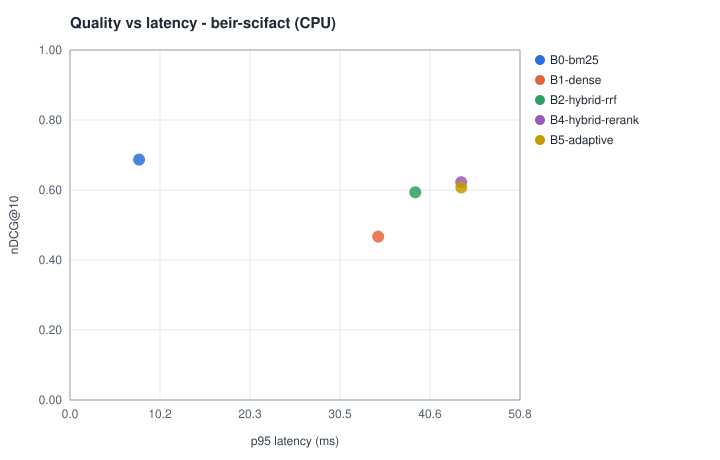

# SearchForge Search-Quality Report — `beir-scifact`

> **PUBLIC-DATASET STUDY (CPU).** BEIR SciFact test split (5,183 abstracts, 300 claims), measured on a
> single CPU-only developer machine. Dense retrieval here is the classical TF-IDF + LSA baseline,
> not a neural embedding model.

## Setup

- Corpus: `beir-scifact` — 5183 documents
- Query split: `all` — 300 queries (beir: 300)
- Latency: 1 measured runs per query after warm-up, query cache bypassed; throughput with 4 client threads
- Environment: Python 3.12.13, Windows-11, 12 logical CPUs, 15.6 GB RAM, GPU: none (CPU-only run)
- Total benchmark wall time: 64.5 s

## Main results

| System | nDCG@10 | Recall@20 | MRR | p95 Latency | Index Size |
|---|---|---|---|---|---|
| B0-bm25 | 0.687 | 0.863 | 0.659 | 7.80 ms | 73.9 MB |
| B1-dense | 0.467 | 0.691 | 0.433 | 34.80 ms | 73.9 MB |
| B2-hybrid-rrf | 0.594 | 0.853 | 0.549 | 38.98 ms | 73.9 MB |
| B4-hybrid-rerank | 0.622 | 0.823 | 0.589 | 44.17 ms | 73.9 MB |
| B5-adaptive | 0.607 | 0.839 | 0.568 | 44.18 ms | 73.9 MB |

### Latency, throughput and memory

| System | p50 | p95 | p99 | QPS | Peak RSS (eval) |
|---|---|---|---|---|---|
| B0-bm25 | 4.57 ms | 7.80 ms | 9.72 ms | 372.2 | 180 MB |
| B1-dense | 23.84 ms | 34.80 ms | 40.45 ms | 69.3 | 252 MB |
| B2-hybrid-rrf | 24.21 ms | 38.98 ms | 49.22 ms | 67.9 | 266 MB |
| B4-hybrid-rerank | 34.87 ms | 44.17 ms | 53.32 ms | 45.0 | 286 MB |
| B5-adaptive | 33.01 ms | 44.18 ms | 54.34 ms | 44.1 | 302 MB |

Peak RSS is sampled for the whole process (approximate; includes the Python runtime and all open indexes).

## Quality by query type (nDCG@10)

| Configuration | Beir |
|---|---|
| B0-bm25 | 0.687 |
| B1-dense | 0.467 |
| B2-hybrid-rrf | 0.594 |
| B4-hybrid-rerank | 0.622 |
| B5-adaptive | 0.607 |

## Adaptive routing (`B5-adaptive`)

Planned profile per query (rules-based planner):

| Planned profile | Queries |
|---|---|
| hybrid | 71 |
| hybrid_rerank | 229 |

## Index size by component

| Index | Chunks | Chunk store | Lexical (FTS5) | Dense (+embedder) | Total | Build time | Build peak RSS | Embedding |
|---|---|---|---|---|---|---|---|---|
| scifact | 8638 | 12.0 MB | 17.1 MB | 44.8 MB | 73.9 MB | 10.48 s | 334 MB | tfidf:tfidf-lsa@fit-612099af4c69/256 |

## Query cache

Same 300 queries issued twice with the cache enabled (`B0-bm25`): cold mean 5.07 ms, warm mean 0.121 ms, hits 300, misses 300, 300 entries (~6.7 MB), latency saved 1491.6 ms.

## Regressions vs baseline `B0-bm25` (ndcg@10)

| Candidate | Improved | Regressed | Unchanged | ΔnDCG@10 | ΔRecall@20 | ΔMRR | Δp95 | Critical regressions |
|---|---|---|---|---|---|---|---|---|
| B1-dense | 35 | 136 | 129 | -0.220 | -0.171 | -0.226 | +27.00 ms | none |
| B2-hybrid-rrf | 51 | 84 | 165 | -0.093 | -0.010 | -0.110 | +31.19 ms | none |
| B4-hybrid-rerank | 45 | 76 | 179 | -0.065 | -0.040 | -0.070 | +36.37 ms | none |
| B5-adaptive | 46 | 85 | 169 | -0.080 | -0.024 | -0.092 | +36.38 ms | none |

## Failure analysis

Categories are rule-based *hypotheses* derived from observed evidence (retriever ranks, filters, index membership); see `failures.parquet` per run for the evidence columns.

| System | Missed relevant docs (top-10) | By category |
|---|---|---|
| B0-bm25 | 73 | missed_lexical_match: 54, duplicate_results: 19 |
| B1-dense | 128 | semantic_miss: 103, duplicate_results: 25 |
| B2-hybrid-rrf | 79 | semantic_miss: 31, bad_fusion: 26, duplicate_results: 11, missed_lexical_match: 11 |
| B4-hybrid-rerank | 85 | semantic_miss: 33, bad_rerank: 21, bad_fusion: 14, missed_lexical_match: 13, duplicate_results: 4 |
| B5-adaptive | 81 | semantic_miss: 33, bad_fusion: 20, missed_lexical_match: 12, bad_rerank: 11, duplicate_results: 5 |

## Limitations

- Single dataset (scientific claim verification); results do not transfer to other domains without measurement.
- Dense retrieval is TF-IDF + LSA (256 dims) fitted on the corpus. Neural embeddings (e.g. MiniLM, BGE-small) are the planned next study and are expected to change the hybrid picture.
- The lexical-feature reranker and adaptive rules were not tuned for SciFact (claims are long natural-language queries).
- Latency is in-process on a shared developer machine with other workloads running; treat latency deltas as indicative.
- No significance testing; per-query improved/regressed counts are reported instead.
