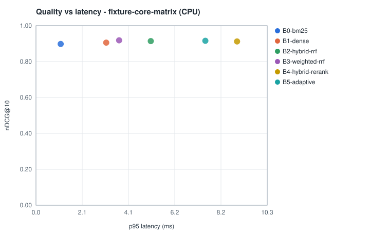

# SearchForge Search-Quality Report — `fixture-core-matrix`

> **LOCAL DEMONSTRATION RESULTS.** Measured on the small synthetic fixture collection shipped with
> SearchForge on a CPU-only machine. These numbers demonstrate the methodology; they are **not**
> industry benchmarks and do not predict behaviour on other corpora.

## Setup

- Corpus: `lumen-fixture-v1` — 48 documents
- Query split: `test` — 20 queries (ambiguous: 3, filter: 4, identifier: 4, keyword: 4, semantic: 5)
- Latency: 3 measured runs per query after warm-up, query cache bypassed; throughput with 4 client threads
- Environment: Python 3.12.13, Windows-11, 12 logical CPUs, 15.6 GB RAM, GPU: none (CPU-only run)
- Total benchmark wall time: 19.1 s

## Main results

| System | nDCG@10 | Recall@20 | MRR | p95 Latency | Index Size |
|---|---|---|---|---|---|
| B0-bm25 | 0.898 | 0.925 | 0.931 | 1.10 ms | 1.7 MB |
| B1-dense | 0.906 | 0.975 | 0.924 | 3.12 ms | 1.7 MB |
| B2-hybrid-rrf | 0.914 | 0.975 | 0.924 | 5.09 ms | 1.7 MB |
| B3-weighted-rrf | 0.918 | 0.975 | 0.925 | 3.69 ms | 1.7 MB |
| B4-hybrid-rerank | 0.912 | 0.975 | 0.920 | 8.92 ms | 1.7 MB |
| B5-adaptive | 0.916 | 0.975 | 0.920 | 7.51 ms | 1.7 MB |

### Latency, throughput and memory

| System | p50 | p95 | p99 | QPS | Peak RSS (eval) |
|---|---|---|---|---|---|
| B0-bm25 | 0.59 ms | 1.10 ms | 1.65 ms | 1079.7 | 143 MB |
| B1-dense | 2.02 ms | 3.12 ms | 3.90 ms | 328.4 | 147 MB |
| B2-hybrid-rrf | 2.39 ms | 5.09 ms | 17.68 ms | 293.0 | 151 MB |
| B3-weighted-rrf | 2.47 ms | 3.69 ms | 4.09 ms | 249.8 | 152 MB |
| B4-hybrid-rerank | 5.83 ms | 8.92 ms | 10.87 ms | 118.5 | 153 MB |
| B5-adaptive | 2.69 ms | 7.51 ms | 8.12 ms | 222.6 | 155 MB |
| F1-normalized-minmax | 2.26 ms | 3.20 ms | 3.51 ms | 262.5 | 156 MB |
| F2-normalized-zscore | 3.10 ms | 4.95 ms | 5.24 ms | 241.3 | 157 MB |
| F3-hybrid-rewrite | 2.33 ms | 3.39 ms | 3.46 ms | 284.9 | 157 MB |
| D20-rerank-20 | 3.04 ms | 3.76 ms | 4.52 ms | 251.9 | 159 MB |
| D50-rerank-50 | 5.61 ms | 6.78 ms | 7.82 ms | 148.9 | 159 MB |
| D100-rerank-100 | 8.69 ms | 10.41 ms | 12.25 ms | 93.8 | 161 MB |
| C1-fixed-64tok | 3.91 ms | 6.02 ms | 7.10 ms | 210.1 | 166 MB |
| C2-fixed-128tok-ov32 | 2.81 ms | 3.59 ms | 3.66 ms | 221.4 | 169 MB |
| C3-sentence-400 | 3.26 ms | 4.05 ms | 4.96 ms | 222.8 | 173 MB |
| C4-section-1200 | 2.36 ms | 4.58 ms | 5.17 ms | 249.2 | 176 MB |

Peak RSS is sampled for the whole process (approximate; includes the Python runtime and all open indexes).

## Quality by query type (nDCG@10)

| Configuration | Keyword | Semantic | Identifier | Ambiguous | Filter |
|---|---|---|---|---|---|
| B0-bm25 | 1.000 | 0.677 | 1.000 | 0.926 | 0.949 |
| B1-dense | 1.000 | 0.722 | 0.981 | 0.919 | 0.956 |
| B2-hybrid-rrf | 1.000 | 0.725 | 0.981 | 0.926 | 0.988 |
| B3-weighted-rrf | 1.000 | 0.727 | 1.000 | 0.926 | 0.988 |
| B4-hybrid-rerank | 1.000 | 0.717 | 0.981 | 0.926 | 0.988 |
| B5-adaptive | 1.000 | 0.717 | 1.000 | 0.926 | 0.988 |

## Chunking experiment

| System | Description | Chunks | nDCG@10 | Recall@20 | MRR | p95 | Index Size |
|---|---|---|---|---|---|---|---|
| C1-fixed-64tok | fixed 64 tokens, no overlap | 72 | 0.909 | 0.975 | 0.927 | 6.02 ms | 1.1 MB |
| C2-fixed-128tok-ov32 | fixed 128 tokens, 32 overlap | 49 | 0.912 | 0.950 | 0.935 | 3.59 ms | 789 KB |
| C3-sentence-400 | sentence packing 400 chars, 80 overlap | 78 | 0.906 | 0.950 | 0.920 | 4.05 ms | 1.1 MB |
| C4-section-1200 | section-aware 1200 chars (default index) | 117 | 0.914 | 0.975 | 0.924 | 4.58 ms | 1.7 MB |

## Candidate-depth experiment

| System | Description | Chunks | nDCG@10 | Recall@20 | MRR | p95 | Index Size |
|---|---|---|---|---|---|---|---|
| D20-rerank-20 | retrieve 20 → rerank 20 | 117 | 0.913 | 0.975 | 0.924 | 3.76 ms | 1.7 MB |
| D50-rerank-50 | retrieve 50 → rerank 50 | 117 | 0.912 | 0.975 | 0.920 | 6.78 ms | 1.7 MB |
| D100-rerank-100 | retrieve 100 → rerank 100 | 117 | 0.912 | 0.975 | 0.920 | 10.41 ms | 1.7 MB |

## Fusion experiment

| System | Description | Chunks | nDCG@10 | Recall@20 | MRR | p95 | Index Size |
|---|---|---|---|---|---|---|---|
| F1-normalized-minmax | min-max score fusion 0.5/0.5 | 117 | 0.915 | 0.975 | 0.925 | 3.20 ms | 1.7 MB |
| F2-normalized-zscore | z-score score fusion 0.5/0.5 | 117 | 0.915 | 0.975 | 0.925 | 4.95 ms | 1.7 MB |
| F3-hybrid-rewrite | RRF + acronym/synonym multi-query | 117 | 0.914 | 0.975 | 0.924 | 3.39 ms | 1.7 MB |

## Adaptive routing (`B5-adaptive`)

Planned profile per query (rules-based planner):

| Planned profile | Queries |
|---|---|
| hybrid | 13 |
| hybrid_rerank | 3 |
| lexical | 4 |

## Index size by component

| Index | Chunks | Chunk store | Lexical (FTS5) | Dense (+embedder) | Total | Build time | Build peak RSS | Embedding |
|---|---|---|---|---|---|---|---|---|
| fixture | 117 | 96 KB | 112 KB | 1.5 MB | 1.7 MB | 1.53 s | 142 MB | tfidf:tfidf-lsa@fit-a1cb961e70e7/116 |
| fixture-fixed64 | 72 | 80 KB | 96 KB | 908 KB | 1.1 MB | 0.72 s | 213 MB | tfidf:tfidf-lsa@fit-d669e08cc5b4/71 |
| fixture-fixed128 | 49 | 68 KB | 88 KB | 633 KB | 789 KB | 0.77 s | 218 MB | tfidf:tfidf-lsa@fit-f5a1798bc995/48 |
| fixture-sentence400 | 78 | 84 KB | 100 KB | 987 KB | 1.1 MB | 0.84 s | 222 MB | tfidf:tfidf-lsa@fit-a1c9fb5cd039/77 |

## Query cache

Same 20 queries issued twice with the cache enabled (`B0-bm25`): cold mean 0.84 ms, warm mean 0.073 ms, hits 20, misses 20, 20 entries (~125 KB), latency saved 15.5 ms.

## Regressions vs baseline `B0-bm25` (ndcg@10)

| Candidate | Improved | Regressed | Unchanged | ΔnDCG@10 | ΔRecall@20 | ΔMRR | Δp95 | Critical regressions |
|---|---|---|---|---|---|---|---|---|
| B1-dense | 4 | 4 | 12 | 0.007 | 0.050 | -0.007 | +2.02 ms | none |
| B2-hybrid-rrf | 5 | 1 | 14 | 0.016 | 0.050 | -0.007 | +4.00 ms | none |
| B3-weighted-rrf | 5 | 0 | 15 | 0.020 | 0.050 | -0.006 | +2.59 ms | none |
| B4-hybrid-rerank | 4 | 1 | 15 | 0.014 | 0.050 | -0.012 | +7.82 ms | none |
| B5-adaptive | 4 | 0 | 16 | 0.018 | 0.050 | -0.012 | +6.41 ms | none |
| F1-normalized-minmax | 5 | 2 | 13 | 0.017 | 0.050 | -0.006 | +2.10 ms | none |
| F2-normalized-zscore | 5 | 2 | 13 | 0.017 | 0.050 | -0.006 | +3.86 ms | none |
| F3-hybrid-rewrite | 5 | 1 | 14 | 0.016 | 0.050 | -0.007 | +2.29 ms | none |
| D20-rerank-20 | 4 | 1 | 15 | 0.014 | 0.050 | -0.007 | +2.66 ms | none |
| D50-rerank-50 | 4 | 1 | 15 | 0.014 | 0.050 | -0.012 | +5.69 ms | none |
| D100-rerank-100 | 4 | 1 | 15 | 0.014 | 0.050 | -0.012 | +9.32 ms | none |
| C1-fixed-64tok | 5 | 2 | 13 | 0.011 | 0.050 | -0.005 | +4.92 ms | none |
| C2-fixed-128tok-ov32 | 5 | 3 | 12 | 0.014 | 0.025 | 0.004 | +2.49 ms | none |
| C3-sentence-400 | 6 | 2 | 12 | 0.008 | 0.025 | -0.012 | +2.95 ms | none |
| C4-section-1200 | 5 | 1 | 14 | 0.016 | 0.050 | -0.007 | +3.48 ms | none |

## Failure analysis

Categories are rule-based *hypotheses* derived from observed evidence (retriever ranks, filters, index membership); see `failures.parquet` per run for the evidence columns.

| System | Missed relevant docs (top-10) | By category |
|---|---|---|
| B0-bm25 | 5 | missed_lexical_match: 3, duplicate_results: 2 |
| B1-dense | 2 | duplicate_results: 2 |
| B2-hybrid-rrf | 3 | duplicate_results: 2, bad_fusion: 1 |
| B3-weighted-rrf | 3 | duplicate_results: 2, bad_fusion: 1 |
| B4-hybrid-rerank | 2 | duplicate_results: 2 |
| B5-adaptive | 2 | duplicate_results: 2 |

## Limitations

- The fixture collection is tiny (tens of documents, ~50 queries) and synthetic; differences of a few hundredths in nDCG are within noise. No significance testing is performed at this size.
- The dense baseline is TF-IDF + LSA fitted on the corpus itself — a classical, CPU-only baseline, not a neural embedding model. Neural embeddings/cross-encoders are optional extras and not measured here.
- Latency is measured in-process (no network) on a single shared developer machine after warm-up; sub-10 ms differences are within run-to-run noise.
- The rules-based planner and lexical-feature reranker were designed alongside this collection; validate them on an independent collection (e.g. a BEIR subset) before drawing conclusions.
